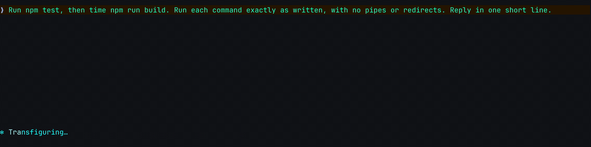
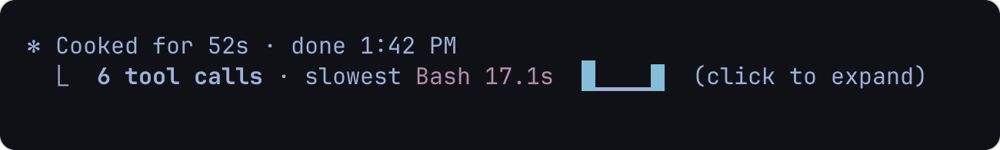
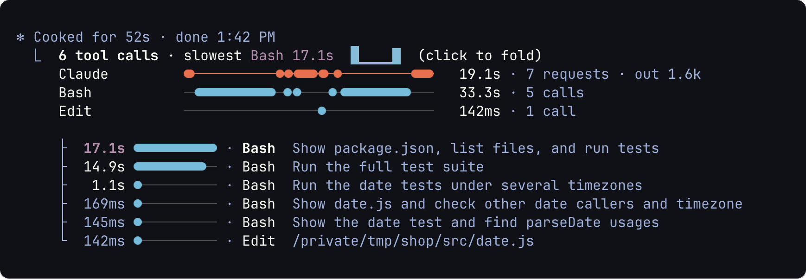
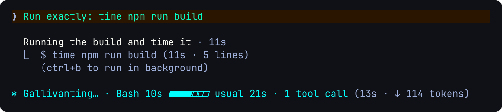
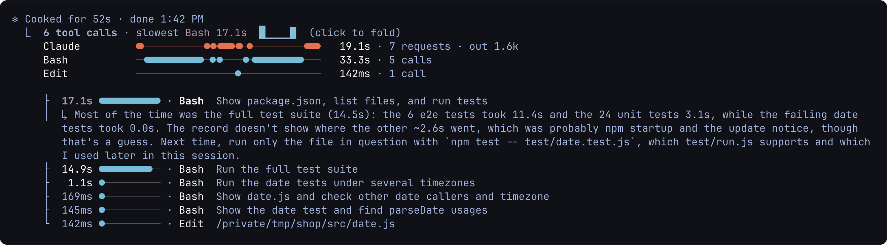
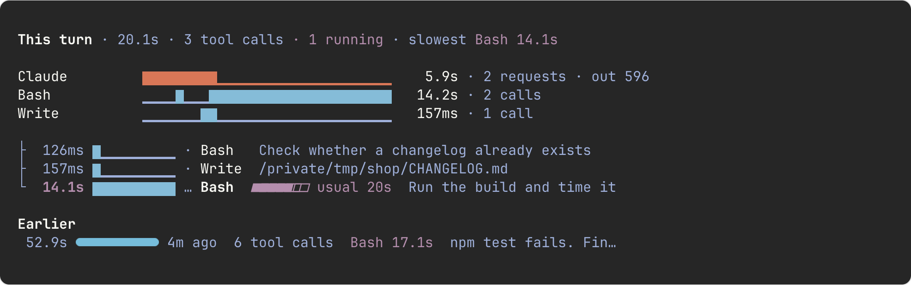
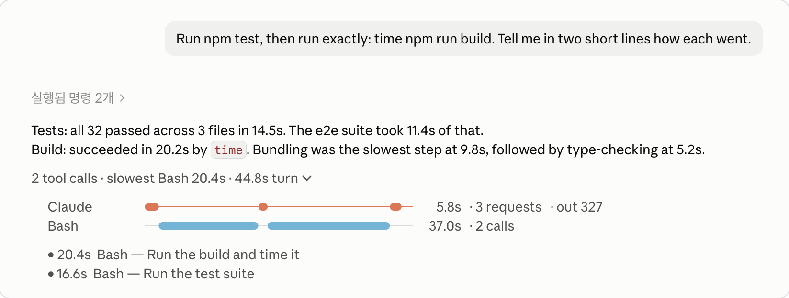

# tool-timeline

English | [한국어](README.ko.md)

**See where each Claude Code turn spent its time.**

When Claude takes a minute to answer, was it thinking, or waiting on `npm test`? tool-timeline adds one line
under every turn that ran tools: how many it ran and which was slowest. Click it and the turn opens into a timeline,
Claude's own requests and each tool on a lane of their own, then every call with how long it took.



<sub>Recorded and screenshotted on a sample project, in Ghostty (through cmux) and in the desktop app.</sub>

## What you get

### One line under each turn that ran tools

Under the line Claude Code closes a turn with (`✻ Cooked for 52s`), one dim line: the number of tool calls, the
slowest one, and a small bar per call in the order they ran (24 bars at most; past that, a bar stands for several
calls, drawn as the slowest of them). Click it to unfold the turn, and again to fold it.





Unfolded, a turn shows:

- **Lanes** across the turn's length: one for Claude's own model requests, one per tool, each with the time it
  kept busy. Claude's lane adds the tokens it wrote, and paints in violet a request that missed the prompt
  cache, which made it slower and dearer. A subagent's calls get lanes of their own (`↳ Bash`).
- **Calls**, the ten slowest, slowest first. A Bash call shows its description rather than the raw command.
  Calls repeated on the same thing share a row (`Bash ×3`). `✗` marks a failed call, `⊘` one refused: by a rule,
  by you at the permission prompt, or by auto mode's classifier.
- **Usual times.** A call that took far longer than that command usually does says so (`usual 8.2s`). Usual is
  the middle of its last 20 runs in this project, kept between sessions, and shows once three are kept. A call's
  time takes in any wait for your permission, so a command you approve each time counts that wait too.

### Live, while Claude works

The spinner names the call running longest, its time ticking. When that command has a usual time, a gauge fills
toward it, and far past it the spinner says by how much (`2.3× usual`).



### Ask why a call was slow

In the terminal, click a call that took 5 seconds or more, or far longer than usual, and Claude says why it took
that long. It answers from the command and the end of its output, kept as the call ran, and where they don't
show where the time went, it says so and calls any guess a guess. The answer hangs under the row; click again
to hide it.



### A pane for the whole session

`/tool-timeline` opens a pane with the turn under way, drawn live, and below it your ten latest turns: how long
each took, how long ago, its slowest call and what you asked. Click one to unfold it there. The turn under way
shows its ten latest calls, an earlier one its ten slowest, and a line counts the rest.



### On the desktop app

The desktop app draws no closing line, so the fold hangs under Claude's final reply, in the dim tone and with the
chevron of the app's own folded rows.



### And a few quiet helpers

- **A notification** when a call that ran 30 seconds or more ends, through the terminal's notification channel.
  The desktop app has no such channel; there only your own `Notification` hooks get it.
- **A heads-up when Claude is going in circles.** When the same Bash command fails three times in a row, a toast
  and a notification say so (`Bash failed 3 times in a row · npm test`), a good moment to step in.
- **Claude knows your slow commands.** With your prompts, unseen by you, Claude is told how long this project's
  slow commands (10 seconds or more) usually take, so it can run a narrower one, or a long one in the background.
- **It survives a restart.** A resumed session still folds the turns it had.

## Install

Needs Claude Code 2.1.295 or later. At the prompt of a terminal session, type:

```
/plugin install tool-timeline --marketplace wonwoo/tool-timeline
```

Answer `y` to add the marketplace, then pick a scope (user is the first). It runs in that session at once, and in
every session after. The desktop app's Code tab does not take this command; installed from a terminal at the user
scope, it runs there too. In Ghostty and kitty the bars are drawn as pictures, as on this page; other terminals
show the same bars in text.

## What it costs and keeps

- **Tokens.** Two things reach the model, the rest is drawn on your machine. Asking why is one model request over
  the session's own transcript, served from its prompt cache while that is warm, and the conversation keeps
  nothing of it. The usual-times note is a few lines with a prompt: on a session's first, then only once those
  times change or the conversation is compacted.
- **Stored.** In Claude Code's plugin store: the last 20 times of each command and tool in each project (1,000 of
  them in all, the least lately run let go), and the finished turns of your latest five sessions. In a turn, a call
  that took a second or more also keeps what asking why answers from: the first 1,000 characters of its command
  and the last 1,000 of its output. The terminal's picture bars are files under `/tmp/tool-timeline/<session>`; a
  session removes, as it starts, the folders not written for a day.
